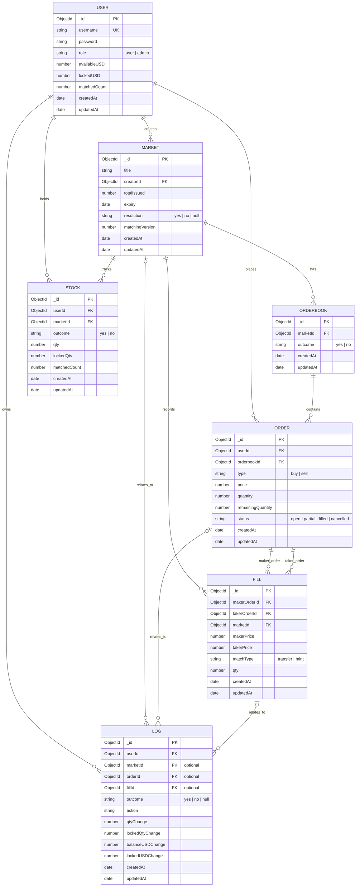

# Mini-Kalshi

A **binary prediction-market backend** inspired by Kalshi, built with **TypeScript, Express, MongoDB, Mongoose, and Bun**. Users can participate in YES/NO markets, place limit orders, split and merge outcome pairs, and track balances and transaction history.

> **Project status:** Backend project under development. The API and data model below reflect the supplied routes and Mongoose schemas.

## Features

- **Authentication and roles:** Sign up, sign in, authenticated endpoints, and role-protected market resolution.
- **Markets:** Create and list markets; split, merge, and resolve YES/NO outcome markets.
- **Order books:** Separate YES and NO books for each market, with buy and sell limit orders.
- **Matching records:** Track **transfer** and **mint** executions through fills.
- **Balances and holdings:** Track available/locked funds and available/locked YES/NO shares.
- **Audit history:** Record onramps, balance locks, trades, splits, merges, refunds, cancellations, and settlements in transaction logs.

## Tech stack

| Layer                       | Technology            |
| --------------------------- | --------------------- |
| Runtime and package manager | [Bun](https://bun.sh) |
| Language                    | TypeScript            |
| HTTP framework              | Express               |
| Database                    | MongoDB               |
| ODM                         | Mongoose              |

## Database schema

The following is an **entity relationship diagram** of the seven Mongoose models. GitHub renders Mermaid diagrams directly in Markdown.



### Model responsibilities

| Model         | Purpose                                                                                   |
| ------------- | ----------------------------------------------------------------------------------------- |
| **User**      | Account, role, available/locked funds, and match count.                                   |
| **Market**    | Market question, creator, expiry, resolution, issued outcome pairs, and matching version. |
| **Orderbook** | One book per market and outcome (YES or NO).                                              |
| **Order**     | Limit buy/sell order with price, quantity, remaining quantity, and lifecycle status.      |
| **Stock**     | A user's YES or NO holdings in one market, including locked quantity.                     |
| **Fill**      | Executed match between maker and taker orders, classified as a transfer or mint.          |
| **Log**       | Per-user accounting/audit entries for cash and share movements.                           |

### Indexes and data constraints

| Model     | Index                                                            | Purpose                                                   |
| --------- | ---------------------------------------------------------------- | --------------------------------------------------------- |
| User      | `username` (unique)                                              | Prevent duplicate usernames.                              |
| Orderbook | `{ marketId: 1, outcome: 1 }` (unique)                           | At most one YES book and one NO book per market.          |
| Stock     | `{ userId: 1, marketId: 1, outcome: 1 }` (unique)                | At most one holding record per user, market, and outcome. |
| Order     | `{ orderbookId: 1, type: 1, status: 1, price: 1, createdAt: 1 }` | Support order-book and matching lookups.                  |

**Notes:** Relationships are Mongoose `ObjectId` references, not database-enforced foreign keys. All seven schemas use `timestamps: true`, adding `createdAt` and `updatedAt`. Order prices are constrained by the schema to **1–99** (intended as cents per share); order quantity has a minimum of **1**.

## How trading works

Each market has two possible outcomes: **YES** and **NO**. It has one order book for each outcome.

1. **Onramp:** A user adds funds to their available balance.
2. **Split:** A user converts funds into matching YES and NO shares; the market's `totalIssued` tracks outstanding issued pairs.
3. **Place order:** A user submits a BUY or SELL limit order to the relevant outcome book. Required funds or shares can be reserved in locked balances.
4. **Match:** Compatible orders execute, creating a `Fill` and updating orders, balances, holdings, and transaction logs.
5. **Merge:** A user converts matched YES and NO shares back into funds, reducing the number of outstanding pairs.
6. **Resolve:** An authorized admin resolves the market to YES or NO.

### Match types

| Type         | Description                                                              | Effect on `totalIssued`            |
| ------------ | ------------------------------------------------------------------------ | ---------------------------------- |
| **Transfer** | A BUY and SELL for the **same outcome** exchange existing shares.        | Unchanged                          |
| **Mint**     | Opposite-outcome BUY orders are matched and new YES/NO pairs are issued. | Increases by matched pair quantity |

A partial match may leave an order with a nonzero `remainingQuantity` and a `partial` status. The model also supports `open`, `filled`, and `cancelled` statuses.

## API reference

**Base URL:** `http://localhost:8000` (when running on the default port). The paths below include the prefixes from `app.use(...)`.

### Authentication and account

| Method | Endpoint                    | Description                          | Authentication |
| ------ | --------------------------- | ------------------------------------ | -------------- |
| `POST` | `/api/v1/auth/signup`       | Register a new user                  | Public         |
| `POST` | `/api/v1/auth/signin`       | Sign in                              | Public         |
| `POST` | `/api/v1/auth/onramp`       | Add funds                            | Required       |
| `GET`  | `/api/v1/auth/profile`      | Get the authenticated user's profile | Required       |
| `GET`  | `/api/v1/auth/transactions` | Get the user's transaction history   | Required       |

### Markets

| Method | Endpoint                                | Description                   | Authentication             |
| ------ | --------------------------------------- | ----------------------------- | -------------------------- |
| `POST` | `/api/v1/market`                        | Create a market               | Required                   |
| `GET`  | `/api/v1/markets`                       | List markets                  | Required                   |
| `POST` | `/api/v1/market/:marketIdParam/split`   | Split funds into YES/NO pairs | Required                   |
| `POST` | `/api/v1/market/:marketIdParam/merge`   | Merge YES/NO pairs            | Required                   |
| `POST` | `/api/v1/market/:marketIdParam/resolve` | Resolve a market              | Required + role middleware |

### Orders

| Method | Endpoint                       | Description                      | Authentication |
| ------ | ------------------------------ | -------------------------------- | -------------- |
| `POST` | `/api/v1/order/:marketIdParam` | Place a YES/NO BUY or SELL order | Required       |

**Authentication:** Protected endpoints use `authMiddleware`. Include the JWT returned by sign-in as a bearer token, assuming your middleware uses the standard `Authorization` header:

```http
Authorization: Bearer <token>
```

**Role authorization:** The resolve route additionally uses `roleMiddleware`. Its exact policy (including whether the admin must also be the market creator) depends on the middleware/controller implementation.

**Parameter:** `:marketIdParam` is the MongoDB market ID in the URL path.

> Request and response JSON examples are not included because the controller validation and response shapes were not provided. The tables above reflect only the registered routes; for example, a cancel-order endpoint is **not** listed because it is not present in the supplied router.

## Getting started

### Prerequisites

- [Bun](https://bun.sh/docs/installation)
- MongoDB (a local instance or a hosted cluster)

### Installation

```bash
git clone <your-repository-url>
cd mini-kalshi
bun install
```

### Environment configuration

Create a `.env` file in the project root. These variables follow the application's previously described configuration; verify them against the current source before deployment.

```dotenv
MONGODB_URI=mongodb://127.0.0.1:27017/mini-kalshi
SECRET_KEY=replace-with-a-strong-secret
PORT=8000
```

Do not commit `.env` or real secrets to Git.

### Run the server

```bash
bun run index.ts
```

If your entry point lives in a different directory, adjust the command accordingly.

## Future improvements

- Add automated unit and end-to-end tests for order matching and accounting invariants.
- Document validated request/response examples and error codes for each endpoint.
- Add an order-cancellation endpoint if/when registered in the API router.
- Strengthen production safeguards around concurrency, idempotency, and monetary precision.

---

Built as a hands-on exploration of **exchange backends, matching engines, and prediction-market accounting**.
