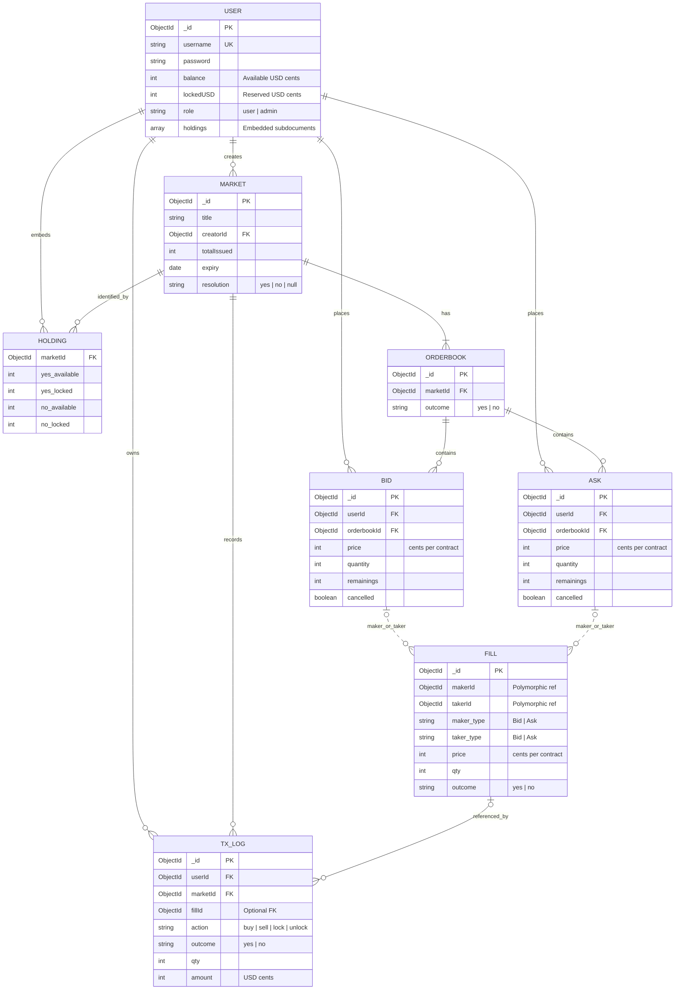

# Prediction Market — Database Schema & Relationships

This diagram reflects the agreed **MongoDB/Mongoose** model. `Bid` and `Ask` are **separate collections**. Each `User` document embeds its own `holdings` array.

## Entity relationship diagram



## Relationship rules

| From | To | Relationship / implementation |
|---|---|---|
| User | Market | One user can create many markets (`Market.creatorId`). |
| Market | OrderBook | Each market has **exactly two** order books: one YES, one NO. Enforce `{ marketId, outcome }` as a unique compound index; create both when the market is created. |
| User | Bid / Ask | One user can place many bids and asks (`userId`). |
| OrderBook | Bid / Ask | One book can have many bids and asks (`orderbookId`). Market and outcome are obtained via the referenced order book. |
| User | Holding | Holdings are **embedded inside User**, not a separate MongoDB collection. Each holding references a market via `marketId`. |
| Fill | Bid / Ask | `makerId` and `takerId` point to either collection as selected by `maker_type` / `taker_type`. Both sides are `Bid` for minting; a `Bid` plus an `Ask` transfers contracts. The dotted diagram edges indicate **conditional/polymorphic** references, not two guaranteed references on every fill. |
| User / Market | TxLog | Every log belongs to a user and a market. `fillId` is optional because locking and unlocking may happen without a fill. |

## Important implementation notes

- **No physical `HOLDING` collection:** It is shown in the diagram only to make the embedded data structure readable.
- **Fill references:** `maker_type` and `taker_type` must match your actual registered Mongoose model names (for example, `Bid` and `Ask`) when used with `refPath`.
- **Contract ownership:** Available and locked quantities live in `User.holdings`.
- **Pending orders:** `remainings` tracks the unmatched quantity; `cancelled` tracks cancellation. A fill is complete when `remainings === 0`, and partial when `0 < remainings < quantity`.
- **Currency:** Store integer cents, not floating point dollars.
- **Market resolution:** `totalIssued` counts **YES/NO pairs**, not individual contracts.
- **Indexes:** Add `{ marketId: 1, outcome: 1 }` unique on OrderBook (and consider indexes on userId / orderbookId for order lookups). Enforce at most one embedded holding per `(user, market)` in application logic.
```

**Mermaid preview:** GitHub and other Mermaid-compatible Markdown viewers render the ER diagram automatically.
